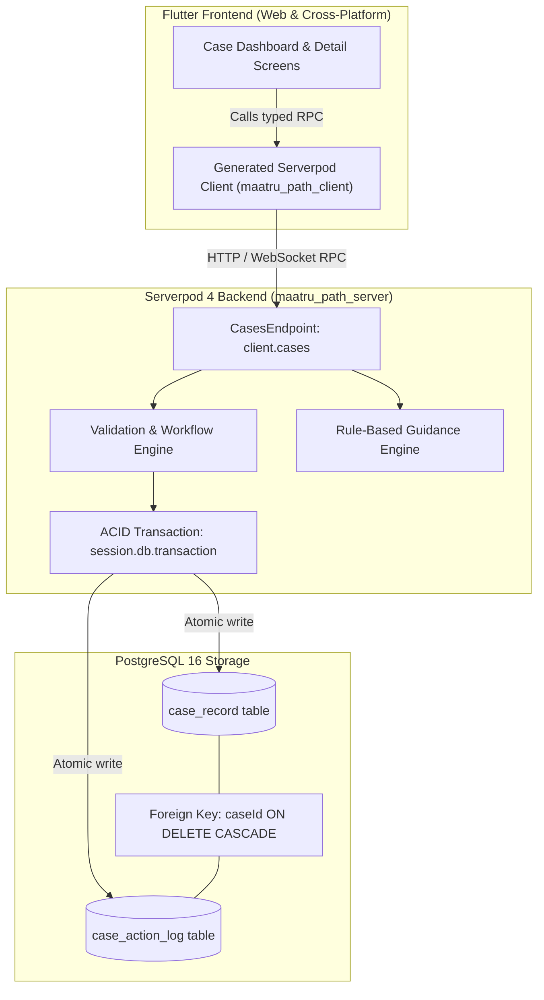
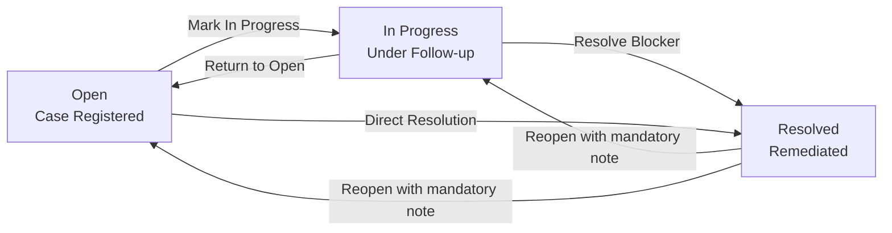

# MaatruPath — Application Blocker Companion

> **A workflow-focused companion that helps community welfare workers document application blockers, record field follow-ups, validate state transitions, and preserve a chronological history toward resolution.**

[](https://flutter.dev)
[](https://dart.dev)
[](https://serverpod.dev)
[](https://www.postgresql.org)
[]()

---

## Quick Summary for Judges (30-Second Overview)

- **Target Users:** Frontline community health and welfare workers (e.g., ASHA and Anganwadi workers) coordinating resolution of stuck maternity and social welfare benefit applications (e.g., PMMVY, JSY).
- **Core Problem:** Benefit disbursements stall due to administrative bottlenecks (demographic mismatches, unmapped DBT bank accounts, missing clinic verification stamps). Case history and next steps remain fragmented across notebooks and unrecorded visits.
- **Implemented Solution:** A full-stack companion with real-time KPI metrics, search/filtering, preconfigured demo scenario templates, category-specific deterministic guidance, and transactional status transitions.
- **Signature Differentiator:** **Blocker-to-Resolution Timeline** — a persistent, chronological audit trail backed by atomic Serverpod transactions (`session.db.transaction`) pairing status transitions and field notes with persisted database records (`CaseActionLog`).
- **Privacy & Safety Safeguard:** Strict synthetic reference validation (`DEMO-` prefix enforced by regex on both client and backend). Real beneficiary Aadhaar numbers, bank account numbers, OTPs, and personal health identifiers are strictly prohibited.

---

## Visual Preview & Interface Walkthrough

> [!NOTE]
> **Screenshot Placeholder:** The repository provides a fully functional web interface runnable locally. To capture genuine application screenshots for presentation or evaluation portfolios, run `serverpod start` and `flutter run -d edge` and capture:
> 1. `docs/screenshots/01_dashboard.png` — Real-time KPI summary cards, filter bar, and registered case cards.
> 2. `docs/screenshots/02_create_case.png` — Registration modal with synthetic demo scenario template chips.
> 3. `docs/screenshots/03_case_detail_actions.png` — Rule-based guidance cards with official department verification links.
> 4. `docs/screenshots/04_timeline.png` — Chronological Blocker-to-Resolution Timeline showing creation, field note, and status transitions.
> 5. `docs/screenshots/05_reopen_dialog.png` — Deliberate case reopening modal with mandatory audit justification.

---

## Table of Contents

1. [Problem and Solution](#problem-and-solution)
2. [Primary Differentiator: Blocker-to-Resolution Timeline](#primary-differentiator-blocker-to-resolution-timeline)
3. [Implemented Feature Set](#implemented-feature-set)
4. [Architecture & System Design](#architecture--system-design)
5. [Why Serverpod?](#why-serverpod)
6. [Technology Stack](#technology-stack)
7. [Data Model & State Transition Workflow](#data-model--state-transition-workflow)
8. [Privacy, Trust, and Responsible Use Safeguards](#privacy-trust-and-responsible-use-safeguards)
9. [Windows Quick Start Guide](#windows-quick-start-guide)
10. [Configuration & Troubleshooting](#configuration--troubleshooting)
11. [Testing & Verification Summary](#testing--verification-summary)
12. [Step-by-Step Repeatable Demo Script](#step-by-step-repeatable-demo-script)
13. [Limitations & Future Roadmap](#limitations--future-roadmap)
14. [Hackathon Submission & Originality Statement](#hackathon-submission--originality-statement)
15. [License & Credits](#license--credits)

---

## Problem and Solution

### The Practical Workflow Problem

In India's social welfare distribution (such as the *Pradhan Mantri Matru Vandana Yojana* [PMMVY] and *Janani Suraksha Yojana* [JSY]), monetary benefit transfers stall at high rates due to administrative obstacles:
- **Fragmented History:** An ASHA worker visits a CSC (Common Service Center) or bank branch, but details of the visit remain in personal pocket notebooks or verbal updates. When colleagues or supervisors review the case, they cannot tell what remediation actions have been attempted.
- **Ambiguous Requirements:** Frontline workers struggle to determine whether a rejection requires an applicant action (e.g., in-person Aadhaar demographic update), a bank visit (NPCI Aadhaar seeding), or official departmental action (Child Development Project Officer [CDPO] verification).
- **No Visibility on Resolution Velocity:** Standard portals provide a static "Pending" or "Rejected" flag without tracking the progression of investigation attempts, follow-up notes, or supervisor reviews.

### The Implemented Solution

MaatruPath provides an end-to-end companion workflow tailored specifically to blocker resolution:
1. **Case Registration:** Workers register stuck cases using synthetic references (`DEMO-PMMVY-001`), classifying scheme, blocker category, priority, and obstacle description.
2. **Deterministic Guidance:** The system evaluates the blocker category against a rule-based engine, returning prioritized next steps and explicitly flagging whether official department verification is required.
3. **Field Follow-Up Logging:** Workers record chronological notes from visits, document reviews, and communications.
4. **Validated Status Progression:** Cases move through controlled lifecycle states (`Open` → `In Progress` → `Resolved`), with support for audited deliberate reopenings.
5. **Timeline Inspection:** Every state change and follow-up note is recorded as a persistent database record (`CaseActionLog`) rendered in a clean visual timeline.
6. **Dashboard Overview:** KPI summary cards and multi-dimensional filters provide immediate situational awareness.

---

## Primary Differentiator: Blocker-to-Resolution Timeline

The hallmark technical and design differentiator of MaatruPath is the **Blocker-to-Resolution Timeline**:

- **Real Database Audit Trail:** Unlike decorative UI activity lists, every timeline node is backed by a discrete, persisted row in the `case_action_log` PostgreSQL table.
- **Atomic Event Recording:** Every case creation, status transition, and note addition is committed in an ACID transaction (`session.db.transaction`) alongside the parent `case_record` mutation.
- **Multi-Event Categorization:** Distinguishes different event types:
  - `created` — Records initial registration, scheme, blocker category, and priority.
  - `status_change` — Captures previous status, new status, and automated transition notes.
  - `note_added` — Captures field notes recorded by workers during follow-up visits.
  - `reopened` — Captures deliberate reopening of a previously resolved case with a required supervisor explanation.
- **Accountability Without Ambiguity:** Provides immediate clarity on:
  - *What obstacle was documented?*
  - *What follow-up steps were attempted?*
  - *When did the status change?*
  - *Does the current state require citizen action or official department verification?*

---

## Implemented Feature Set

### 1. Real-Time Case Dashboard
- **Dynamic KPI Cards:** Calculates live counts for Total Cases, Open Blockers, In Progress, and Resolved directly from backend records.
- **Search Engine:** Filters cases in real time by applicant reference (e.g., `DEMO-001`), scheme name, or obstacle keywords.
- **Multi-Dimensional Filters:** Filter by case status (`All`, `Open`, `In Progress`, `Resolved`) and blocker category (`All Categories`, `Aadhaar Linkage`, `Bank Account / NPCI`, `Documentation`, `Operator Verification`, `Biometric Authentication`, `Mobile Seeding`, `Unclear Requirement`).
- **Responsive Layout:** Adapts dynamically across wide desktop viewports (constrained max width with two-column filters) and compact mobile viewports (expanded full-width inputs, adaptive badges, and resilient flex wrapping).

### 2. Case Registration & Synthetic Demo Templates
- **Synthetic Reference Validation:** Strictly enforces the `^DEMO-[A-Za-z0-9_\-]+$` pattern on both Flutter client and Serverpod backend to prevent entry of real beneficiary personal data.
- **One-Click Demo Scenario Templates:**
  - `DEMO: Aadhaar Mismatch` — Prefills demographic name spelling discrepancy under PMMVY (High Priority).
  - `DEMO: NPCI DBT Inactive` — Prefills bank branch merger / Aadhaar mandate mapping failure under JSY (High Priority).
  - `DEMO: Missing MCP Stamp` — Prefills missing health officer sign-off on Mother & Child Protection card (Medium Priority).
  - `DEMO: CSC Biometric Failure` — Prefills repeated fingerprint sensor authentication failure (Medium Priority).

### 3. Case Details & Recommended Next Actions
- **Deterministic Guidance Engine:** Evaluates blocker categories on the backend (`CasesEndpoint.getRecommendedActions`) and returns typed `RecommendedAction` objects containing:
  - Concise obstacle explanation.
  - Prioritized immediate next action.
  - Practical field follow-up suggestion.
  - Explicit boolean flag `requiresOfficialVerification`.
  - Verified official portal link (e.g., UIDAI, NPCI, PMMVY portal) where applicable.

### 4. Interactive Resolution Workflow
- **State Transition Buttons:** Contextual action controls ("Mark In Progress", "Resolve Blocker", "Deliberate Reopen").
- **Audit-Logged Reopening:** Prompt dialog requiring an explicit reason before allowing a `Resolved` case to transition back to `In Progress` or `Open`.
- **Field Note Recorder:** Validated input (3–1000 characters) committing follow-up notes atomically to the case timeline.

---

## Architecture & System Design

MaatruPath follows a layered full-stack architecture using Serverpod's strongly-typed RPC protocols and PostgreSQL persistence.



### Communication Flow:
1. **Client Invocation:** The Flutter application invokes strongly-typed RPC methods via `client.cases.<method>()` without writing boilerplate REST serializations.
2. **Serverpod Session Handling:** Calls pass through `Session`, where input strings are validated against regular expressions, length constraints, and whitelisted category/priority enums.
3. **Atomic Persistence:** When creating cases, updating statuses, or adding notes, Serverpod opens an ACID transaction (`session.db.transaction`), ensuring that the primary record in `case_record` and the corresponding audit log in `case_action_log` succeed or fail together.
4. **Relational Integrity:** Foreign key constraint `case_action_log_fk_0` links `caseId` to `case_record(id)` with `ON DELETE CASCADE`.

---

## Why Serverpod?

Serverpod 4 was selected for MaatruPath to address the specific architectural requirements of a welfare blocker companion:

1. **Shared Type System & Protocol Generation:**
   Models defined in `.spy.yaml` (`CaseRecord`, `CaseActionLog`, `RecommendedAction`, `CaseOperationException`) compile into Dart classes on both the server and Flutter client. Eliminates manual JSON parsing, typos in field names, and serialization bugs.
2. **Transactional Database ORM:**
   Community worker audit trails require strict transactional guarantees. Serverpod's `session.db.transaction` allows writing the status update and creating the audit log in a single PostgreSQL transaction.
3. **Type-Safe RPC Communication:**
   Endpoints extend `Endpoint`, allowing the Flutter application to call `client.cases.createCase(newCase)` as if calling a local Dart method, complete with code completion, static type checking, and compile-time verification.
4. **Safe Typed Exceptions:**
   Serverpod custom exception serialization (`CaseOperationException`) transfers structured error messages across the network boundary, displaying clean validation feedback to workers without leaking stack traces or unhandled exceptions.
5. **Native Dart Ecosystem:**
   Both backend endpoints and frontend UI are written in modern Dart 3, sharing linting rules, formatting standards, and debugging workflows in a single workspace.

---

## Technology Stack

| Layer | Technology | Observed Version | Purpose |
|---|---|---|---|
| **Frontend Framework** | Flutter | `3.47.7` (`^3.44.4`) | Cross-platform UI (Web, Desktop, Mobile) |
| **Language** | Dart SDK | `3.13.5` (`^3.12.2`) | Strongly-typed full-stack language |
| **Backend Framework** | Serverpod | `4.0.4` | RPC server, ORM, and code generation |
| **Database** | PostgreSQL | `16.x` | Relational persistence with foreign keys & ACID transactions |
| **Client RPC** | `maatru_path_client` | Generated (`4.0.4`) | Auto-generated strongly-typed client library |
| **Styling & Theme** | Google Fonts (`Inter`) | `^8.1.0` | Professional typography & theme tokens |
| **Icons** | Cupertino & Material Icons | Standard | Visual indicators for status, priority, and actions |

---

## Data Model & State Transition Workflow

### 1. Database Schema

#### Table: `case_record`
| Column | Type | Constraints | Description |
|---|---|---|---|
| `id` | `bigserial` | Primary Key | Auto-incrementing unique identifier |
| `applicantReference` | `text` | NOT NULL | Synthetic identifier (must match `^DEMO-[A-Za-z0-9_\-]+$`) |
| `schemeName` | `text` | NOT NULL | Welfare scheme name (e.g., `PMMVY`, `JSY`) |
| `blockerCategory` | `text` | NOT NULL | One of 7 validated categories |
| `blockerDescription` | `text` | NOT NULL | Obstacle explanation (5 to 1000 characters) |
| `priority` | `text` | NOT NULL | Restricted to `High`, `Medium`, or `Low` |
| `status` | `text` | NOT NULL | Current status (`Open`, `In Progress`, `Resolved`) |
| `createdAt` | `timestamp` | DEFAULT now() | Record creation timestamp |
| `updatedAt` | `timestamp` | Nullable | Last modification timestamp |

#### Table: `case_action_log`
| Column | Type | Constraints | Description |
|---|---|---|---|
| `id` | `bigserial` | Primary Key | Auto-incrementing log ID |
| `caseId` | `bigint` | NOT NULL, FK → `case_record(id)` CASCADE | Associated case identifier |
| `actionType` | `text` | NOT NULL | `created`, `status_change`, `note_added`, or `reopened` |
| `previousStatus` | `text` | Nullable | Status before transition |
| `newStatus` | `text` | Nullable | Status after transition |
| `note` | `text` | Nullable | Associated field note or audit explanation |
| `createdAt` | `timestamp` | DEFAULT now() | Action recording timestamp |

### 2. State Transition Workflow

The state machine enforces deliberate, validated status transitions:



- **Open → In Progress:** Worker begins active field investigation or assistance.
- **In Progress → Resolved:** Obstacle remediated and benefit processing can resume.
- **Open → Resolved:** Direct resolution when an obstacle is verified as remediated upon intake.
- **In Progress → Open:** Reverts case to open backlog if field follow-up is paused or re-assigned.
- **Resolved → In Progress / Open:** Deliberate reopening requires entering a justification note in a confirmation modal, recorded in the timeline as an audited `reopened` action event.

---

## Privacy, Trust, and Responsible Use Safeguards

> [!IMPORTANT]
> **Scope & Disclaimer Notice:**
> - **Community Companion, Not Government Portal:** MaatruPath is a productivity companion for frontline welfare workers. It does not claim government affiliation, endorsement, or eligibility authority.
> - **Synthetic References Only:** All demonstration data must use synthetic references starting with `DEMO-`. Real Aadhaar numbers (12-digit UID), bank account credentials, PINs, OTPs, or confidential medical records must never be entered.
> - **Input Validation Guardrails:** The client form and backend endpoint strictly validate that applicant references match `^DEMO-[A-Za-z0-9_\-]+$`, rejecting arbitrary digits or unformatted inputs.
> - **Guidance vs. Official Authority:** Category recommendations provide structured guidance to streamline worker follow-ups. They do not guarantee eligibility or benefit disbursement. Official government portals are linked for authoritative verification.

---

## Windows Quick Start Guide

This guide describes how to run and verify MaatruPath locally on Windows.

### Prerequisites
- **Flutter SDK:** Version `3.47.x` or compatible with Dart `3.13.x`
- **Dart SDK:** Version `3.13.5` or higher
- **Serverpod CLI:** Version `4.0.4` (`dart pub global activate serverpod_cli 4.0.4`)
- **PostgreSQL:** Local PostgreSQL service running on port `8090` (or Docker running Serverpod's container)
- **Browser:** Microsoft Edge (available by default on Windows) or Google Chrome

---

### Step 1: Clone and Inspect Directory
```powershell
git clone https://github.com/red-coder-27/maatru-path.git
cd maatru_path
```

---

### Step 2: Install Workspace Dependencies & Configure Passwords
Run `dart pub get` from the workspace root or each package directory:
```powershell
cd maatru_path_server
dart pub get

cd ..\maatru_path_flutter
flutter pub get

cd ..
```

#### Passwords & Secrets Setup
Serverpod manages database credentials and service secrets via `maatru_path_server/config/passwords.yaml` (safely excluded from Git).
A safe template is provided at [`maatru_path_server/config/passwords.yaml.template`](maatru_path_server/config/passwords.yaml.template):
```powershell
# If creating credentials manually or configuring for custom PostgreSQL:
Copy-Item maatru_path_server\config\passwords.yaml.template maatru_path_server\config\passwords.yaml
```
Alternatively, Serverpod supports standard environment variables without editing files:
- `SERVERPOD_PASSWORD_database`: Database password
- `SERVERPOD_PASSWORD_redis`: Redis password

---

### Step 3: Start the Serverpod Backend (Terminal 1)
In a dedicated PowerShell window:
```powershell
cd maatru_path_server
serverpod start
```
*Expected Console Output:*
- Applies pending database migrations automatically.
- Boots API Server on `http://localhost:8080`
- Boots Insights Server on `http://localhost:8081`
- Boots Web Server on `http://localhost:8082`

---

### Step 4: Launch the Flutter Web Application (Terminal 2)
In a second PowerShell window:
```powershell
cd maatru_path_flutter
flutter run -d edge
```
*Tip:* You can also launch using Chrome by passing `-d chrome`.

The web application will open in Microsoft Edge connected to the live Serverpod backend at `http://localhost:8080/`.

---

## Configuration & Troubleshooting

### Port Allocations
- **API Server:** `8080` (Client RPC communication)
- **Insights Server:** `8081` (Serverpod diagnostics dashboard)
- **Web Server:** `8082` (Serverpod web server)
- **PostgreSQL Database:** `8090` (Configured in `maatru_path_server/config/development.yaml`)

### Common Diagnostics & Verified Solutions

| Symptom | Probable Cause | Verified Solution |
|---|---|---|
| `Serverpod could not connect to the database` | PostgreSQL is not running or listening on port `8090` | Verify PostgreSQL is running on port 8090, or verify credentials in `maatru_path_server/config/passwords.yaml`. |
| `An InputDecorator cannot have an unbounded width` | Unconstrained `Row` child in Flutter dashboard | Resolved: All filter dropdowns and metric cards are enclosed in explicit `SizedBox` or `Expanded` containers. |
| `Missing DEMO- prefix` | Reference validation failure | Enter a reference starting with `DEMO-` (e.g., `DEMO-PMMVY-001`) or click a preconfigured Demo Template chip. |
| Flutter web app displays white screen on initial load | Client could not reach `http://localhost:8080/` | Ensure Terminal 1 (`serverpod start`) is running before opening the Flutter web app. |

---

## Testing & Verification Summary

### Automated Test Suites

#### 1. Backend Business Rules Unit Tests
```powershell
cd maatru_path_server
dart test test/unit/case_logic_test.dart
```
**Observed Result:** `00:00 +5: All tests passed!`
- Validates synthetic applicant reference regex enforcement (`DEMO-`).
- Validates priority whitelist (`High`, `Medium`, `Low`).
- Validates status whitelist (`Open`, `In Progress`, `Resolved`).
- Validates exhaustive category catalog.
- Validates state transition rules and deliberate reopening constraints.

#### 2. Flutter Widget & Constraint Tests
```powershell
cd maatru_path_flutter
flutter test
```
**Observed Result:** `00:06 +8: All tests passed!`
- Validates `PrivacyBanner` rendering and synthetic disclaimer.
- Validates `StatusBadge` & `PriorityBadge` visual values.
- Validates `TimelineItem` rendering and chronological action log node.
- Validates `CreateCaseScreen` form validation and demo template prefilling.
- Validates `CaseDashboardScreen` desktop layout constraint (1280x800) without unbounded-width assertion.
- Validates `CaseDashboardScreen` compact mobile layout (400x800) without render flex overflow.
- Validates `New Case` navigation button interaction.
- Validates `Status` and `Category` filter dropdown interactive selection.

#### 3. Static Analysis
```powershell
dart analyze maatru_path_server
dart analyze maatru_path_flutter
```
**Observed Result:** `No issues found!` across both server and client packages.

### Verification Matrix

| Capability | Verification Method | Actual Result | Notes / Environment Limitations |
|---|---|---|---|
| **Dashboard Layout** | `flutter test` + Live Edge run | ✅ Verified Working | Clean layout across desktop (1280px) and compact (400px) screens |
| **Case Creation** | Live Serverpod RPC verification | ✅ Verified Working | Case and initial action log atomically created via transaction |
| **Deterministic Guidance** | Live RPC (`getRecommendedActions`) | ✅ Verified Working | Categorized next steps and official verification links returned |
| **Follow-up Note Logging** | Live RPC (`addFollowUpNote`) | ✅ Verified Working | Notes appended to timeline with exact timestamps |
| **Status Transitions** | Live RPC (`updateBlockerStatus`) | ✅ Verified Working | State progression and deliberate reopening modal verified |
| **Persistence After Refresh** | Browser refresh testing | ✅ Verified Working | Persisted in PostgreSQL and reloaded from backend |
| **Backend Integration Tests** | `dart test test/integration/` | ⚠️ Limited by Local Policy | Offline test runner's embedded `initdb.exe` binary blocked by Windows WDAC/AppLocker. All endpoints verified live via RPC suite. |

---

## Step-by-Step Repeatable Demo Script

Follow this 2-minute walkthrough to evaluate the complete end-to-end workflow:

1. **Open the Dashboard:**
   Navigate to the web app (`http://localhost:<flutter-port>`). Observe live KPI summary cards (Total Cases, Open Blockers, In Progress, Resolved) dynamically populated from PostgreSQL.
2. **Launch the Registration Form:**
   Click **"New Case"** in the top navigation bar.
3. **Use an Instant Demo Template:**
   In the registration modal, click the green template chip: **`DEMO: Aadhaar Mismatch`**.
   - *Observed Result:* Form auto-fills reference `DEMO-PMMVY-001`, scheme `PMMVY`, category `Aadhaar Linkage`, priority `High`, and the mismatch description.
4. **Save the Case:**
   Click **"Save Case to Serverpod"**.
   - *Observed Result:* Confirmation snackbar confirms creation; backend transaction creates case `#<id>` and initial `created` audit event.
5. **Inspect Case Details & Guidance:**
   Click the newly created case card from the dashboard list.
   - *Observed Result:* View the **Recommended Next Actions** panel displaying prioritized steps, follow-up timeline suggestions, and an official verification link to UIDAI.
6. **Advance Lifecycle to "In Progress":**
   Click **"Mark In Progress"**.
   - *Observed Result:* Badge updates to `In Progress`; a new `status_change` node appears in the **Blocker-to-Resolution Timeline**.
7. **Record a Follow-Up Note:**
   In the "Record Follow-Up Note" box, type:
   > *"Visited CSC center; operator confirmed demographic update request URN."*
   Click **"Record Follow-Up"**.
   - *Observed Result:* A new `note_added` timeline item appears with an exact server timestamp.
8. **Resolve the Blocker:**
   Click **"Resolve Blocker"**.
   - *Observed Result:* Case status updates to `Resolved`; resolution node recorded in the timeline.
9. **Verify Persistence Across Browser Refresh:**
   Refresh the browser page (`F5`).
   - *Observed Result:* The case remains in `Resolved` status; reopening the case displays the complete persisted timeline from PostgreSQL.
10. **Demonstrate Audited Reopening:**
    Click **"Deliberate Reopen"**. In the prompt dialog, enter:
    > *"Supervisor requested secondary verification of updated bank passbook."*
    Click **"Reopen Case"**.
    - *Observed Result:* Status transitions back to `In Progress`, and an audited `reopened` event is recorded on the timeline.

---

## Limitations & Future Roadmap

### Current Implementation Scope
- Fully functioning single-tenant MVP focused on frontline worker blocker resolution.
- Deterministic, rule-based recommendation engine for 7 core welfare obstacle categories.
- Local PostgreSQL persistence with Serverpod ORM and transactions.
- Web and responsive cross-platform Flutter frontend.

### Known Limitations
- **Single-Tenant / Unauthenticated:** The MVP operates in open companion mode without role-based access control (RBAC) or multi-user login.
- **Offline Sync:** Requires connectivity to the Serverpod backend; local-first SQLite caching with background sync is not yet implemented.
- **Embedded Test Runner Policy:** Running embedded Postgres tests via `serverpod_test` on certain Windows enterprise editions can encounter WDAC binary execution blocks, requiring testing against the running server.

### Future Roadmap
1. **Serverpod Auth Integration:** Enable secure worker login with phone OTP or credentials using `serverpod_auth`.
2. **Offline-First Synchronization:** Implement local device caching with conflict resolution for remote rural workers with intermittent connectivity.
3. **Multi-Language Localization:** Add support for Hindi and regional Indian languages using Flutter's localization framework.
4. **Exportable Case Summary:** Generate PDF case resolution summaries for block-level grievance redressal meetings.

---

## Hackathon Submission & Originality Statement

### 30-Second Elevator Pitch
> **MaatruPath** is a full-stack companion for community welfare workers built with Flutter and Serverpod 4. It transforms fragmented application blocker follow-ups into structured, auditable resolution paths using transactional status tracking, deterministic guidance, and a signature **Blocker-to-Resolution Timeline**.

### Three Key Differentiators
1. **Persistent Blocker-to-Resolution Timeline:** Every lifecycle event is an atomic, immutable database record in PostgreSQL rather than an ephemeral client-side UI state.
2. **Backend-Validated Workflow Engine:** ACID transactions enforce state machine transitions, note length constraints, and deliberate reopening justifications.
3. **Distinction Between Guidance and Verification:** Category-specific guidance explicitly distinguishes between practical advice and steps requiring official department verification.

### Technical Contribution
The project implements a clean separation of concerns across a modern Dart 3 full-stack architecture:
- Relational schema modeling connecting `case_record` to `case_action_log` with cascading integrity.
- Serverpod endpoints utilizing ACID database transactions (`session.db.transaction`) to guarantee consistency between application state and audit history.
- Responsive Flutter interface engineered to prevent unbounded-width layout assertions and ensure graceful rendering on both desktop and mobile viewports.

---

## License & Credits

### License
This project is licensed under the MIT License — see the [LICENSE](LICENSE) file for details.

### Credits & Attribution
- Built with [Serverpod](https://serverpod.dev/) — The missing backend for Flutter.
- Built with [Flutter](https://flutter.dev/) — Google's cross-platform UI toolkit.
- Typography powered by [Google Fonts (Inter)](https://fonts.google.com/specimen/Inter).
- Icons provided by Flutter Material Design & Cupertino icon libraries.
